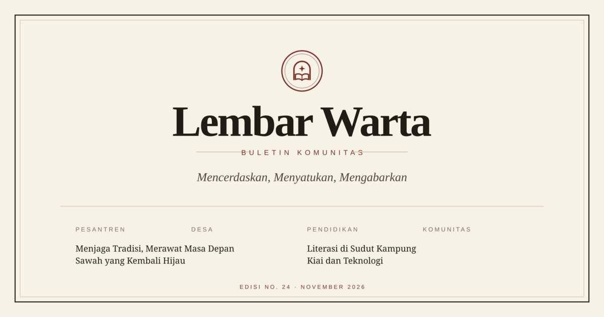

# Lembar Warta

Buletin komunitas bergaya cetak: sederhana, klasik, dan nyaman dibaca. Cocok untuk buletin pesantren, desa, organisasi, atau komunitas yang ingin punya rumah digital tanpa kehilangan nuansa kertas.



## Daftar Isi

- [Fitur](#fitur)
- [Teknologi](#teknologi)
- [Menjalankan Proyek](#menjalankan-proyek)
- [Struktur Proyek](#struktur-proyek)
- [Kustomisasi](#kustomisasi)
- [Deploy ke GitHub Pages](#deploy-ke-github-pages)
- [Catatan Kontak & PDF](#catatan-kontak--pdf)
- [Lisensi](#lisensi)

## Fitur

- **Beranda editorial** — artikel unggulan, pilihan redaksi, artikel terbaru, rubrik, dan sorotan edisi terbaru.
- **Daftar artikel** — pencarian judul/penulis/isi dan filter per rubrik. Filter dapat dibuka lewat tautan, mis. `#/artikel?kategori=desa`.
- **Detail artikel** — judul, penulis, tanggal, estimasi waktu baca, gambar, isi bergaya buletin (drop cap, kutipan, subjudul), tombol bagikan, cetak, dan artikel terkait.
- **Edisi & arsip** — daftar edisi bulanan dengan unduhan PDF. Enam contoh PDF sudah disertakan.
- **Tentang Kami** — profil lembaga, nilai redaksi, susunan redaksi, dan alur kerja.
- **Kontak** — formulir yang membuka aplikasi surel pengunjung, info sekretariat, panduan kirim tulisan, dan FAQ.
- **Logo & favicon** — emblem buletin dalam format SVG, plus ikon Apple Touch dan gambar Open Graph.
- **Responsif & aksesibel** — navigasi mobile, tautan lewati konten, fokus keyboard, dan struktur semantik.
- **Siap GitHub Pages** — routing memakai hash, sehingga tidak perlu konfigurasi server atau aturan rewrite.

## Teknologi

| Bagian | Keterangan |
| --- | --- |
| Framework | [Svelte 5](https://svelte.dev/) |
| Build tool | [Vite 8](https://vite.dev/) |
| Bahasa | TypeScript |
| Styling | [Tailwind CSS v4](https://tailwindcss.com/) via `@tailwindcss/vite` |
| Deploy | [gh-pages](https://github.com/tschaub/gh-pages) (`bun run deploy`) |
| Tipografi | Source Serif 4 & Libre Franklin (Google Fonts, dengan fallback sistem) |
| Routing | Router hash ringan buatan sendiri (`src/lib/router.ts`) |

## Menjalankan Proyek

Prasyarat: Node.js 20+ dan salah satu dari `bun` atau `npm`.

```bash
# dengan Bun (disarankan, sesuai bun.lock)
bun install
bun run dev

# atau dengan npm
npm install
npm run dev
```

Buka alamat yang ditampilkan Vite, biasanya `http://localhost:5173`.

Perintah lain:

```bash
bun run check    # cek TypeScript & Svelte
bun run build    # build produksi ke folder dist/
bun run preview  # pratinjau hasil build
bun run deploy   # build + publikasikan ke branch gh-pages
```

## Struktur Proyek

```text
.
├─ public/
│  ├─ favicon.svg                 # favicon utama
│  ├─ apple-touch-icon.png        # ikon 180×180
│  ├─ logo.svg                    # logo lockup untuk dokumentasi
│  ├─ og-image.svg / .png         # gambar pratinjau media sosial
│  ├─ images/                     # ilustrasi artikel (SVG)
│  └─ pdf/                        # berkas edisi PDF
├─ src/
│  ├─ App.svelte                  # layout, routing, judul halaman
│  ├─ app.css                     # token Tailwind, tipografi, gaya cetak
│  ├─ main.ts
│  └─ lib/
│     ├─ data.ts                  # situs, rubrik, artikel, edisi
│     ├─ router.ts                # router hash
│     ├─ components/              # Header, Footer, Logo, kartu, dsb.
│     └─ pages/                   # Beranda, Artikel, Detail, Edisi, Tentang, Kontak
├─ index.html                     # meta, font, favicon, Open Graph
├─ vite.config.ts                 # plugin Svelte + Tailwind, base path
└─ package.json
```

## Kustomisasi

### 1. Identitas dan isi

Hampir semua konten berada di **`src/lib/data.ts`**:

- `site` — nama, tagline, deskripsi, edisi berjalan, alamat, surel, telepon, dan tautan sosial.
- `categories` — rubrik beserta deskripsinya.
- `articles` — daftar artikel. Setiap artikel memiliki `slug`, judul, ringkasan, rubrik, penulis, tanggal, gambar, dan isi HTML.
- `editions` — daftar edisi, ringkasan, sorotan, jumlah halaman, dan lokasi berkas PDF.

Setelah mengubah data, periksa kembali:

- `slug` artikel harus unik karena dipakai pada URL `#/artikel/<slug>`.
- `image` merujuk ke berkas di `public/images/`, tanpa garis miring di awal.
- `file` merujuk ke berkas di `public/pdf/`.
- `featured: true` menandai artikel utama di beranda. Jika tidak ada, artikel pertama dipakai.

### 2. Gambar dan PDF

- Ganti ilustrasi di `public/images/`. Rasio yang disarankan **3:2** (mis. 1200×800). Format SVG, WebP, atau JPG didukung.
- Ganti berkas PDF di `public/pdf/` dengan nama yang sama, atau sesuaikan nilai `file` pada `editions`.
- Sampul edisi memakai gambar artikel (`cover`), jadi Anda bisa memakai ulang ilustrasi yang ada atau menyiapkan sampul khusus.

### 3. Warna dan tipografi

Token warna dan font didefinisikan di blok `@theme` pada **`src/app.css`**:

```css
@theme {
  --color-paper: #f7f2e6;
  --color-ink: #211c16;
  --color-accent: #7c2f27;
  --font-serif: 'Source Serif 4', Georgia, serif;
  --font-sans: 'Libre Franklin', system-ui, sans-serif;
}
```

Mengubah token di sana akan memperbarui seluruh situs. Font dimuat dari Google Fonts di `index.html`; ganti tautannya bila ingin memakai font lain, atau hapus tautan tersebut untuk mengandalkan font sistem.

### 4. Logo dan favicon

- `public/favicon.svg` — favicon utama (SVG).
- `public/apple-touch-icon.png` — ikon untuk perangkat Apple.
- `public/logo.svg` — lockup logo untuk dokumentasi atau materi cetak.
- `src/lib/components/Logo.svelte` — emblem yang dipakai di header dan footer.

Jika mengganti logo, sesuaikan juga `public/og-image.svg` lalu buat ulang `public/og-image.png` (mis. dengan ImageMagick: `convert -density 200 public/og-image.svg -resize 1200x630 public/og-image.png`).

### 5. Navigasi dan halaman

Rute yang tersedia:

| Rute | Halaman |
| --- | --- |
| `#/` | Beranda |
| `#/artikel` | Daftar artikel |
| `#/artikel?kategori=desa` | Daftar artikel terfilter |
| `#/artikel/<slug>` | Detail artikel |
| `#/edisi` | Edisi & arsip |
| `#/tentang` | Tentang Kami |
| `#/kontak` | Kontak |

Karena memakai hash, tautan dapat dibuka langsung tanpa konfigurasi server. Untuk menambah halaman baru, buat komponen di `src/lib/pages/`, lalu daftarkan di `src/App.svelte` dan `Header.svelte`.

## Deploy ke GitHub Pages

Deploy memakai paket **`gh-pages`**, bukan GitHub Actions. Perintah `bun run deploy` akan:

1. Membangun situs ke folder `dist/` dengan path aset relatif.
2. Mendorong isi `dist/` ke branch `gh-pages`.
3. Menambahkan berkas `.nojekyll` agar GitHub Pages tidak memproses situs dengan Jekyll.

### Persiapan pertama kali

1. Buat repositori di GitHub, lalu hubungkan remote dan push branch `main`:

   ```bash
   git remote add origin git@github.com:<username>/<nama-repo>.git
   git push -u origin main
   ```

2. Pasang dependensi (termasuk `gh-pages`):

   ```bash
   bun install
   ```

3. Jalankan deploy:

   ```bash
   bun run deploy
   ```

4. Buka **Settings → Pages** di repositori GitHub.
5. Pada **Build and deployment → Source**, pilih **Deploy from a branch**.
6. Pilih branch **`gh-pages`** dan folder **`/ (root)`**, lalu simpan.
7. Situs tersedia di `https://<username>.github.io/<nama-repo>/`.

### Deploy berikutnya

Setiap kali ada perubahan, cukup jalankan:

```bash
bun run deploy
```

Branch `gh-pages` akan diperbarui otomatis. Tidak perlu mengaktifkan GitHub Actions.

### Base path

Build memakai base relatif (`./`), sehingga aset, favicon, gambar, dan PDF tetap ditemukan baik di:

- `https://<username>.github.io/<nama-repo>/`
- `https://<username>.github.io/` (repositori `<username>.github.io`)
- domain kustom

Jika ingin memaksa base absolut, gunakan env `BASE_PATH`:

```bash
BASE_PATH=/lembar-warta/ bun run build
```

### Domain kustom

Tambahkan berkas `CNAME` berisi nama domain ke folder `public/`, lalu jalankan `bun run deploy` lagi. Alternatifnya, jalankan langsung:

```bash
bunx gh-pages -d dist --nojekyll --cname buletin.contoh.id
```

### Jika deploy gagal

- Pastikan remote `origin` sudah benar: `git remote -v`.
- Pastikan Anda punya izin push ke repositori.
- Untuk autentikasi, gunakan SSH atau Personal Access Token sesuai pengaturan GitHub Anda.
- Folder `dist/` tidak perlu di-commit; ia dibuat ulang setiap kali deploy.

## Catatan Kontak & PDF

- Formulir kontak **tidak mengirim data ke server**. Saat dikirim, formulir menyusun pesan lalu membuka aplikasi surel pengunjung melalui tautan `mailto:`. Ini membuat situs tetap bisa berjalan di hosting statis.
- Untuk formulir yang benar-benar mengirim pesan, hubungkan ke layanan seperti Formspree, Getform, Netlify Forms, atau API milik sendiri. Ubah `handleSubmit` di `src/lib/pages/Contact.svelte`.
- Berkas PDF di `public/pdf/` adalah **contoh** yang dibuat untuk demonstrasi. Ganti dengan edisi asli organisasi Anda. Ukuran dan jumlah halaman pada `src/lib/data.ts` sebaiknya disesuaikan dengan berkas baru.
- Semua nama, artikel, alamat, dan tokoh dalam demo ini bersifat fiktif.

## Lisensi

Kode proyek ini bebas digunakan, dimodifikasi, dan disesuaikan untuk kebutuhan komunitas. Konten contoh (teks, ilustrasi, dan PDF) disediakan untuk keperluan demonstrasi; silakan ganti dengan konten milik Anda.

---

Dibuat dengan tenang untuk kabar-kabar yang layak dirawat.
